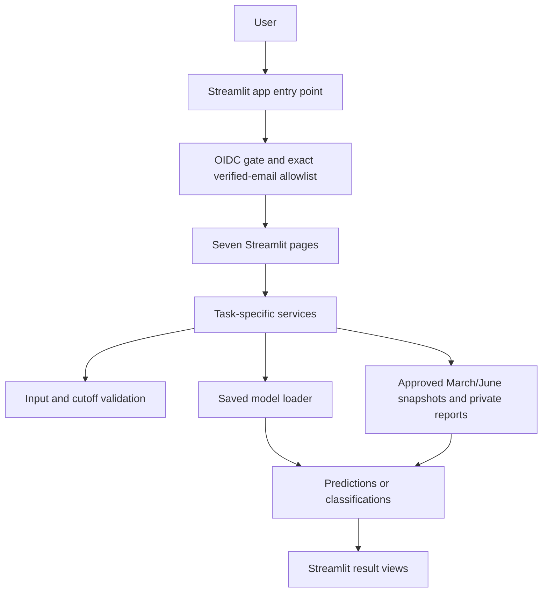
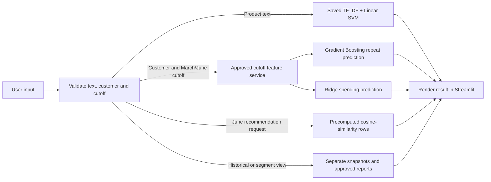

# AI Smart Shopping Assistant — Final Project Documentation

## Project overview

This repository contains a Streamlit portfolio prototype for product text classification and historical retail analytics. It combines saved scikit-learn models, cutoff-specific feature inputs, June-only precomputed recommendations, March/June customer summaries, and precomputed analysis reports. It is not a live commerce service and is not production-ready.

The product-description classifier and retail transaction data are separate data families. Customer snapshots, supervised features, recommendation outputs, customer insight tables, and model reports are separate artifacts. They must not be described as one merged dataset.

## Architecture



The application registers navigation only after its authentication gate. Runtime services use local configured files; there is no database, product catalog API, or commerce integration. Model artifacts and customer-level files are private runtime dependencies and are not part of the public candidate allowlist.

### Implemented pages and modules

| Page or module | Behavior |
| --- | --- |
| Overview | Reads the separate March and June customer snapshots and approved cluster profile summary. |
| Product Classification | Loads a saved TF-IDF and Linear SVM pipeline for product description text. |
| Recommendations | Returns precomputed June-only item-item cosine-similarity rows; no on-demand fallback for unknown customers. |
| Customer Intelligence | Uses separate historical snapshots and approved insights/segment lookup services. |
| Predictions | Uses Gradient Boosting for repeat purchase and Ridge Regression for spending, with March/June feature records. |
| Customer Segments | Presents precomputed March/June assignments and summaries for a three-cluster March-fitted KMeans analysis. |
| Model Insights | Displays saved importance, comparison, residual and perturbation reports. |
| Explainability | Uses native importance, coefficient magnitude, June permutation importance, and fixed-cohort zero-feature perturbation examples. No SHAP implementation exists. |

No sentiment-analysis subsystem is implemented.

## Data, preprocessing, and feature engineering

The customer temporal protocol is March 2011 for model training/fitting, June 2011 for validation, and September 2011 as a protected holdout. No September-derived records or metrics are presented here. The text-classification test split is separate from the customer time split.

Historical customer snapshots are separate March and June files. Snapshot measures include gross spending, invoice count, quantity, distinct products, recency, average invoice value, active months, and weekday invoice count, subject to the approved Phase 1/2 transaction acceptance rules. The source does not establish a currency denomination.

The project keeps task-specific feature families for repeat purchase, spending, recommendations, and segmentation. The documented pipeline applies cutoff validation and required-column/type checks, excludes target and identifier columns from predictors, and uses March-fitted imputation/scaling where specified. Recommendation outputs are June-only. Segmentation assignments are descriptive, not ranked customer-value labels.

## Models and verified evaluation results

These figures are transcribed from existing evaluation reports and the prior documentation audit; they have not been recomputed for this package.

| Task | Method | Reported result | Evaluation boundary |
| --- | --- | --- | --- |
| Product classification | TF-IDF + Linear SVM | 95.80% accuracy; macro precision 0.960613, macro recall 0.955156, macro F1 0.957788 | Separate product-text test split, 4,171 rows |
| Repeat-purchase prediction | Gradient Boosting | Accuracy 0.683959; F1 0.690896; ROC-AUC 0.749553; average precision 0.773749 | June validation |
| Spending prediction | Ridge Regression | MAE 533.927631; RMSE 1541.713665; R² 0.682499 | June validation; no currency label |
| Recommendations | Item-item cosine similarity | NDCG@10 0.133916; hit rate@10 0.359455; catalog coverage 0.613753 | June-only evaluation |
| Segmentation | KMeans | 3 descriptive clusters | March fit; June transformed/described |

No independent September holdout score is claimed. Spending estimates are unconstrained and may be negative. Recommendation rows are precomputed rather than generated by an online ranking call.

## Application workflow



## Setup and execution

Use standard CPython 3.14.3 and a fresh environment. The pinned deployment requirements describe direct dependencies; they are not a fully resolved transitive lock. Private models and approved March/June runtime artifacts must be provided locally through a separately reviewed private process.

Windows PowerShell from the project root:

```powershell
py -3.14 -m venv .venv-local
.\.venv-local\Scripts\Activate.ps1
python -m pip install -r requirements-deployment.txt
python -m pip check
python -m streamlit run app.py --server.headless true --server.port 8501
```

Configure Google OIDC values from `.streamlit/secrets.toml.example` in a local ignored secrets file or a secret manager. Any visitor with a verified Google account can authenticate and use the demo; no email allowlist is required. Missing or invalid authentication settings fail closed. No live identity-provider configuration is present in this workspace.

The existing unit suite uses synthetic fixtures and temporary model-loader objects. Run it from the project root with:

```powershell
python -m unittest discover -s tests -p "test_*.py" -v
```

Streamlit's `/_stcore/health` checks process liveness; it does not verify login, model/data readiness, or page workflows.

## Project structure

```text
app.py                         Authenticated Streamlit entry point
pages/                         Seven dashboard pages
src/config/                    Model, data, and predictor paths
src/models/                    Saved artifact loader
src/preprocessing/             Input and feature validation
src/services/                  Classification, recommendation, prediction, segmentation, insight services
src/ui/                        Authentication, dashboard data, navigation, shared components
datasets/                      Private input and derived artifacts; exclude from release
models/                        Private saved models; exclude from release
deployment_staging/            Ignored local model-only staging bundle
tests/                         Synthetic unit, integration, isolation, and auth tests
docs/                          Project, data, setup, and deployment documentation
reports/                       Internal audit and phase records; exclude by default
```

## Quality and security status

The Phase 17 report records 96 unit tests passing after fixture sanitization and the prior final audit records all seven page files rendered in Streamlit AppTest. The checks do not establish live browser behavior, responsive layout, accessibility, performance, live identity-provider behavior, cloud data controls, or production reliability. No authentic browser screenshots are included.

The public release candidate is an allowlist, not the whole workspace. Exclude all datasets, models, deployment staging, environment folders, secrets, local paths, customer-level outputs, and internal reports. `.gitignore` is defense in depth; it does not replace reviewing an exact staged set. No Git repository currently exists, so tracked status is unknown.

## Limitations and future improvements

- Configure and exercise a real OIDC provider, exact access assignments, callback, logout, session expiry, and recovery.
- Design private artifact provisioning and verify cloud ACLs, residency, logging, backup, and restore before any real-data hosting.
- Perform browser navigation, responsive-layout, keyboard/screen-reader accessibility, security, concurrency, and performance checks.
- Establish a platform-specific, fully resolved dependency lock and reproducible build for the approved host.
- Consider on-demand recommendation ranking only after a safe serving design and evaluation are approved.
- Revisit unconstrained spending outputs and provide a currency label only if the source establishes one.
- Add genuine, sanitized screenshots only after browser review.
- Keep the September holdout protected; any future evaluation must follow its explicit authorization and protocol.

## Deployment position

No repository was created or published and no deployment was performed. Azure App Service is a possible private-hosting candidate for further design because the official runtime documentation lists Python 3.14 and supports private endpoints on selected paid plans. That does not prove this Streamlit application is configured, secured, or compatible there. A cost estimate, region, authentication integration, private storage path, startup configuration, and security review remain open. Streamlit Community Cloud is suitable only for a synthetic-data demo until customer-data access and sharing are independently approved; its documentation describes public-by-default behavior for public repositories, private-app constraints, and U.S.-hosted app infrastructure.

## Project references

- [Architecture and modules](architecture-and-modules.md)
- [Data and evaluation](data-and-evaluation.md)
- [Local setup](running-locally.md)
- [Deployment guide](deployment-guide.md)
- [Deployment security](deployment-security.md)

Internal phase reports, release inventories, and exclusion lists are private workspace records and are not linked as public documentation.

External hosting documentation reviewed for current constraints: [Azure App Service Python runtime](https://learn.microsoft.com/en-us/azure/app-service/configure-language-python), [Azure App Service private endpoints](https://learn.microsoft.com/en-us/azure/app-service/networking/private-endpoint), [Streamlit Community Cloud security](https://docs.streamlit.io/deploy/streamlit-community-cloud/get-started/trust-and-security), and [Streamlit Community Cloud status and limitations](https://docs.streamlit.io/deploy/streamlit-community-cloud/status).
